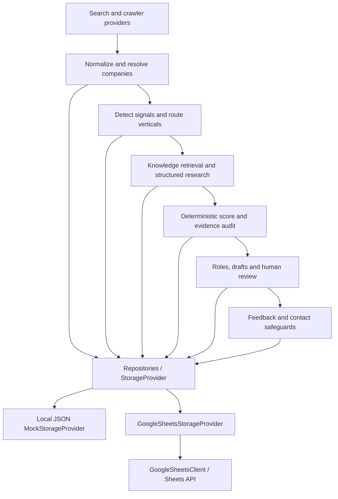

# Novation LeadOS

LeadOS links business events to evidence, Novation services, explainable scores and a human review queue. It contains **nine verticals, 114 signals and 40 synthetic companies**. The dashboard, signal rules, deterministic scoring and evidence gates remain in the backend.

**Google Sheets is the V1 operational storage target.** `StorageProvider` separates the core from its storage engine. Default `LEADOS_STORAGE=mock` uses atomic local JSON, so the whole application works before Google credentials are connected. The configured live workbook has also been exercised. It opens on **LEADOS_MASTER_VIEW**, a backend-generated overview with one row per opportunity; the 19 technical tabs remain intact and hidden by default.

Approval never sends an email. V1 has an independent transport stop even when `ENABLE_EMAIL_SEND=true`. Mock discovery stays local. Live discovery supports Exa, Firecrawl, OpenAI research and embeddings. ContactOut buyer lookup with Snov.io work-email verification and approval-gated HubSpot company sync are available on live opportunity briefs. SMTP and n8n are optional; email delivery remains disabled.

See the [Sheets acceptance report](docs/GOOGLE_SHEETS_ACCEPTANCE.md), [workbook and authentication guide](docs/GOOGLE_SHEETS.md), and [file inventory](docs/FILES_CREATED.md).

The [master-view acceptance report](docs/MASTER_VIEW_ACCEPTANCE.md) records the current presentation changes, live validation, file inventory, and exact setup commands.

## Start locally

Prerequisites: Python 3.12+, Node.js 24 and npm. From the project root:

```sh
cp .env.example .env
make setup seed demo
```

`make setup` creates `.venv` and installs locked Python and frontend dependencies. `make seed` loads runtime signal metadata and non-sensitive settings. `make demo` runs all market fixtures and prints an example for every vertical. No database service or migration is required for mock/Sheets storage.

Start the API in one terminal:

```sh
make backend
```

Start the dashboard in another:

```sh
make frontend
```

Open [the dashboard](http://localhost:3000), [API documentation](http://localhost:8000/docs), or [storage health](http://localhost:8000/storage/health). Click Run mock discovery if the demo has not been run. Select a company to examine facts, allegations, inferences, source evidence, score components, proposed service, buyer roles and a draft. Enter a reviewer to approve, reject or request research; record outcomes in Feedback.

The data is synthetic, and `.example` source URLs are fixture identifiers. One deliberately invalid URL produces an expected `PARTIAL` run. Valid records finish: **40 companies, 36 company signals, 44 opportunities**. Repeat discovery adds zero duplicate entities, preserves scores/reviews/feedback, and updates observation timestamps. Fixture dates are anchored around 6 October 2026; later assessment dates can reduce recency scores.

The existing SQLite data was preserved and imported into `data/leados.json`, retaining company/opportunity IDs, scores, one review and one feedback record. The old database is retained for migration/reference only.

## Architecture



`backend/leados/storage/records.py` defines typed domain records with no ORM or Google imports. StorageProvider provides indexed typed CRUD and coordinated units of work. Company, signal, opportunity, evidence, review, feedback and outreach repositories use that contract. Provider selection is isolated in `storage/factory.py`. Core API, CLI, engine, knowledge, pipeline and safety modules import neither SQL nor Google APIs; a regression test enforces this boundary.

```text
backend/leados/            API, rules, pipeline, safety and schemas
  storage/                 Contract, repositories, JSON/Sheets providers, typed records,
                           row schemas, REST client, fake client, setup and data transfer
  providers/base/          Search/crawler/LLM/embedding/contact/CRM/email contracts
  providers/mock/          Network-free market and research adapters
  providers/future/        Disabled real vendor extension points
backend/tests/             Domain, API, both storage providers, safety and legacy migrations
knowledge/                 Canonical verticals, signal catalog and central scoring settings
fixtures/market.json        40 synthetic companies / 44 raw records
scripts/                   Workbook setup/validation, export/import, legacy SQL migration, demo
workflows/                 Inactive manual and scheduled n8n exports
docs/                      Workbook columns, acceptance results and screenshots
frontend/                  Next.js/TypeScript review UI
```

`models.py`, `db.py` and Alembic migrations remain isolated legacy SQL artifacts for the import tool and future adapter work. They are not the operational persistence layer. A future SQL provider can implement StorageProvider without changing event detection, routing, scoring, evidence, review or dashboard logic.

## Workbook

Use one existing spreadsheet named **NOVATION_LEADOS_MASTER**. Setup preserves the 16 entity tabs and three support tabs, then creates **LEADOS_MASTER_VIEW** as the first and only visible tab. Its 16 visible columns cover company, trigger, service, score, evidence, source, buyer, review and outreach; four identity/timestamp helpers are hidden. `SHOW_TECHNICAL_SHEETS=true` unhides tabs for debugging. Every technical tab's columns, aliases, enums and purpose are documented in [GOOGLE_SHEETS.md](docs/GOOGLE_SHEETS.md).

The application syncs the overview after committed discovery, review, draft, evidence and feedback changes. Backend records remain authoritative; editing a master cell does not approve a lead. `POST /storage/master-view/sync` retries a sync without discovery, and `GET /storage/master-view/status` validates its content and layout. JSON mode writes a local `*-master-view.json` artifact instead of accessing Google.

Rows carry immutable backend-generated UUIDs. Row positions are temporary lookup locations, never IDs. Signal UUIDs are deterministic; `signal_key` preserves the canonical catalog code. Vertical/service definitions stay in repository knowledge files; Sheets contains their references and runtime metadata. Sheets is not a vector store.

The adapter batch-loads bounded ranges into local indexes, validates headers and rows, checks references and unique keys, then batches changed records using Sheets `batchUpdate`. Backend batches include a commit UUID. A durable local outbox reconciles ambiguous timeouts before retries, preventing blind duplicate appends. Writes are serialized using the API lock and a shared filesystem lock.

Current entities update by UUID after a fresh lookup; reviews, feedback and audit events append. Provider runs append versioned immutable snapshots. Historical scores/components remain unchanged on repeat discovery. Invalid rows are quarantined and audited, with affected identities/fingerprints blocked from duplicate creation. Corrupted rows are retained for correction. Unaffected records can continue where safe. Unknown user columns are preserved and logged; missing required columns stop writes with a clear error.

Keep one backend writer host, with the same lock/outbox paths for CLI jobs. Independent servers on different machines cannot coordinate through this filesystem lock. Sort/edit structural columns between runs: Sheets has no server-side row locking, so a human sort in the narrow read/write interval cannot be fully prevented by the API. Header/UUID warnings and row validation reduce accidental edits. The default limit is 10,000 rows per tab, with bounded payloads; archive/export growing history before reaching it.

## Connect Google Sheets later

1. Create a Google Cloud project and enable Google Sheets API.
2. Create a dedicated service account and obtain its JSON key using your organization's allowed credential process. Keep the key outside the repository.
3. Create the spreadsheet named NOVATION_LEADOS_MASTER. Share **only that spreadsheet** with the service account's email as Editor.
4. Copy the spreadsheet ID from its URL and set the variables in `.env` below.
5. Initialize, validate and seed; then restart the backend.

```dotenv
LEADOS_MODE=mock
LEADOS_STORAGE=google_sheets
GOOGLE_SHEETS_ENABLED=true
GOOGLE_SPREADSHEET_ID=your-spreadsheet-id
GOOGLE_SERVICE_ACCOUNT_JSON_PATH=/absolute/private/path/service-account.json
ENABLE_EMAIL_SEND=false
```

```sh
.venv/bin/python scripts/setup_google_sheets.py
.venv/bin/python scripts/validate_google_sheets.py
make seed
make backend
```

The client requests only the Sheets read/write scope. It does not request Drive API access; effective file access comes from sharing permissions. The dedicated account should have access only to the intended workbook. Detailed steps and official references are in [the authentication guide](docs/GOOGLE_SHEETS.md). Inline `GOOGLE_SERVICE_ACCOUNT_JSON` is also supported as an environment secret; the private file is preferred. Credentials never enter Sheets, responses, logs or the outbox.

To transfer current local mock data before switching, run `make export`; switch configuration and initialize the workbook, then:

```sh
.venv/bin/python scripts/import_leados_data.py --input data/export/leados.json
```

Import preserves IDs, reviews, feedback, score snapshots and provider-run history. Existing identical records are skipped; conflicting records fail rather than overwrite history. Once an adapter is implemented for SQL or another store, the same export/import contract applies.

## Local workbook validation without Google

```sh
.venv/bin/python scripts/setup_google_sheets.py --mock
.venv/bin/python scripts/validate_google_sheets.py --mock
```

These commands create/validate `data/mock-workbook.json` with a fake client. They do not connect to Google. The test suite also executes the complete pipeline against the actual Sheets adapter backed by this fake client.

## Commands

| Command | Purpose |
|---|---|
| `make setup` | Locked dependency installation |
| `make seed` | Runtime knowledge metadata and non-secret settings |
| `make fixtures` / `make pipeline` | Run market fixtures |
| `make demo` | Print all-nine-vertical acceptance examples |
| `make backend` / `make frontend` | Development servers |
| `make validate` | Tests, lint, type checks, frontend build, workflow validation |
| `make setup-sheets` | Initialize configured Google workbook |
| `make validate-sheets` | Validate configured workbook |
| `make export` | Portable JSON and CSV export to `data/export` |
| `.venv/bin/python scripts/import_leados_data.py --input PATH` | Portable JSON import |
| `.venv/bin/python scripts/validate_google_sheets.py --recover` | Reconcile/retry the known pending Sheets write |
| `.venv/bin/python scripts/acceptance_demo.py` | Isolated API approval/feedback/dedup/send-block demo |
| `make migrate` | Optional legacy SQL migration only |
| `make up` | Compose startup |

If migrating older SQLite data into an empty target provider, use `.venv/bin/python scripts/import_legacy_sqlite.py`. `DATABASE_URL` is used only by that tool and legacy migrations. Keep the original database until export/import checks pass. Production frontend: `cd frontend && npm run build && npm run start`.

## API and n8n

All established endpoints remain. `POST /pipeline/process` aliases a complete pipeline run. `GET /storage/health` reports the selected provider, connectivity, schema/row validity, pending writes and storage/client metrics without credentials. `POST /opportunities/{id}/monitor` appends a MONITOR review. Swagger documents the contracts.

Opportunity filters remain vertical, minimum score, event date, review status, industry and country. Highest score sorts first. Feedback status/reason remain separate, with original score and score/knowledge/signal versions.

Import [workflows/mock_manual.json](workflows/mock_manual.json) and [workflows/mock_schedule.json](workflows/mock_schedule.json) into n8n. Both remain **inactive**. HTTP stage nodes call LeadOS; there are no Sheets formulas, Google Sheets nodes, GPT decision nodes or email/CRM-write nodes. Only verified scores ≥80 receive human review tasks. A custom workflow can call `POST /pipeline/process` and inspect `human_review_ids`.

Inside Compose, nodes use `http://backend:8000`. For native n8n, change every HTTP-node URL to `http://127.0.0.1:8000`. Core decisions remain in LeadOS regardless of orchestration.

## Docker

Compose now contains **backend, frontend and n8n**, with a persistent JSON/outbox volume; PostgreSQL is not required. Set a local n8n encryption key in `.env`, then:

```sh
docker compose up --build -d
docker compose ps
docker compose exec n8n n8n import:workflow --input=/workflows/mock_manual.json
docker compose exec n8n n8n import:workflow --input=/workflows/mock_schedule.json
```

Services bind to localhost: dashboard 3000, API 8000, n8n 5678. `docker compose down` keeps volumes. Docker is absent on this host, so container startup remains unverified. For Google credential files in Docker, mount the private host file read-only using a local Compose override and set the environment path to its container path. Never bake credentials into an image.

## Scoring, evidence and outreach

One backend scoring service calculates eight bounded components: need /25, ICP /20, trigger /20, recency /10, mandate /10, buyer reachability /5, expertise /5 and evidence /5. Signal strength is normalized; no LLM invents a final score. Central configuration remains `knowledge/scoring.json`. HOT ≥80, STRONG ≥65, MONITOR ≥50, IGNORE below 50. Evidence audit separately prevents unsupported HOT opportunities, and persisted components are validated against the official total/band.

Facts, allegations, inferences and commercial theses are distinct. Only verified factual evidence can support a draft. Sending checks an actual latest approved review, evidence, company/domain/email suppression, prior contact, enabled flag, approved draft and validated contact before V1's unconditional transport stop. Editing an opportunity cell to APPROVED does not create a review or send anything.

Exa, Firecrawl, OpenAI, ContactOut, Snov.io and HubSpot adapters are connected through environment-held keys. Use the dashboard’s **Check connections** button for authenticated access checks. Exa access is verified when a bounded search runs. See [integration operations](docs/integrations.md) for workflow gates and validation. Live-market scoring calibration and shared-deployment access control remain operational work. No ML model is trained in V1.
